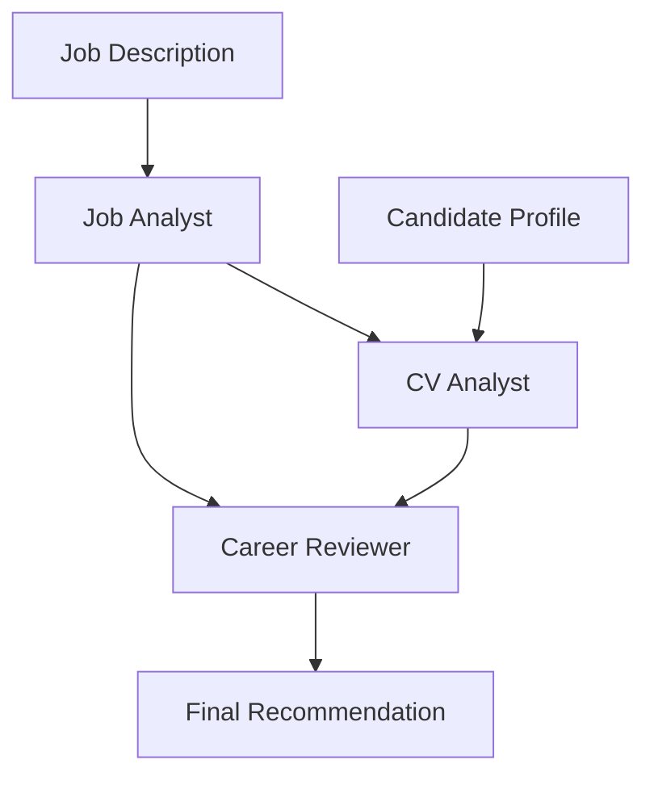

# AutoGen Job Application Reviewer

A simple multi-agent AI project built with Microsoft AutoGen and a local Llama 3.2 model through Ollama.

The project analyzes a job description, compares it with a candidate profile, and produces a final application recommendation.

The entire system runs locally without paid APIs.

## Project Goal

The goal of this project is to understand the fundamentals of multi-agent orchestration using AutoGen.

Instead of using one AI prompt for the entire task, the workflow assigns different responsibilities to three specialized agents.

## Architecture



## Agents

### 1. Job Analyst

Analyzes the job description and identifies:

- required skills
- responsibilities
- seniority
- key requirements

### 2. CV Analyst

Receives the output generated by the Job Analyst and compares it with the candidate profile.

It identifies:

- strong matches
- skill gaps

### 3. Career Reviewer

Receives the previous analyses and generates:

- fit score
- APPLY / DON'T APPLY recommendation
- top strengths
- top gaps
- final recommendation

## Workflow

The information flows sequentially between the agents:

```text
Job Description
      ↓
Job Analyst
      ↓
Job Analysis
      ↓
CV Analyst
      ↓
CV Analysis
      ↓
Career Reviewer
      ↓
Final Recommendation
```

Each agent uses the same local language model but has a different role and system instruction.

## Technology Stack

- Python
- Microsoft AutoGen
- Ollama
- Llama 3.2
- Local LLM inference

## Why Ollama?

Ollama allows the language model to run locally.

This means:

- no OpenAI API key
- no paid API
- no token costs
- local execution

## Installation

### Requirements

- Python 3.10+
- Ollama

Install Python dependencies:

```bash
pip install -r requirements.txt
```

Download the local model:

```bash
ollama pull llama3.2
```

Run the project:

```bash
python main.py
```

## Example Output

The application produces three stages of analysis:

```text
--- JOB ANALYSIS ---

Required AI and automation skills...

--- CV ANALYSIS ---

Strong matches:
...

Gaps:
...

--- FINAL REVIEW ---

FIT SCORE: 70/100
DECISION: APPLY

TOP 3 STRENGTHS:
...

TOP 3 GAPS:
...

FINAL RECOMMENDATION:
...
```

The exact output can vary because it is generated by the language model.

## What I Learned

This project helped me understand:

- how AI agents are defined
- how different system prompts create specialized agent roles
- how one agent's output can become another agent's input
- basic multi-agent orchestration
- how AutoGen manages AI agents
- how to connect AutoGen to a local LLM
- how Ollama can replace paid API calls for simple AI projects

## Current Scope

This project is intentionally simple.

It focuses on understanding agent orchestration rather than building a production application.

Possible future improvements include:

- function calling
- RAG
- persistent agent memory
- automatic CV file upload
- dynamic job description input
- web interface